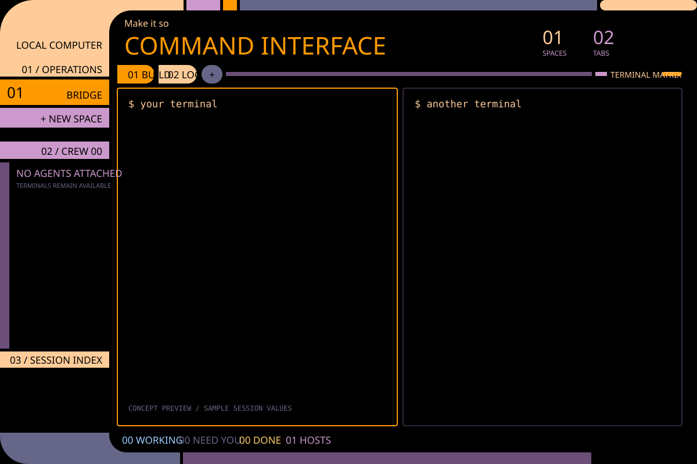

# Make it so for Herdr

Star TrekのLCARSに着想を得た、非公式のHerdrテーマです。

## 導入

1. `layouts/make-it-so.json` と `mods/make-it-so/` を、Herdrの設定フォルダー（通常 `~/.config/herdr-app`）の同じ場所にコピーします。`HERDR_APP_HOME` を設定している場合はそのフォルダーを使います。
2. Herdrのコマンドパレットで `Layout / Make-it-so` を選びます。

[動作確認](TEST-RESULTS.txt) · [ライセンス](THIRD-PARTY-NOTICES.md) · [出典](SOURCES.md)
