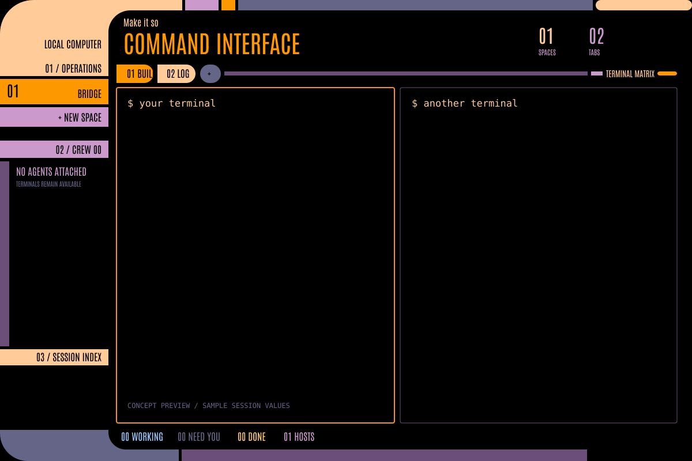

# Make it so

An unofficial command-console layout for Herdr. Peach and lilac rails wrap a black workspace, with a live overview of spaces and crew beside the regular terminal panes.

## What you see

- A 104 px draggable header with a peach elbow, the active space name, local date and live counts of spaces and visible tabs.
- A scrollable 188 px rail for numbered spaces, crew and session counts. A 32 px strip above the terminals shows the active space's tabs.
- Native terminal panes in the middle. A 58 px footer carries the menu, agent and host counts, palette and clock. The UI uses Antonio and the terminal uses JetBrains Mono.

## How it behaves

Orange marks the active space or tab. Working is blue, blocked is red and pulses when it is not selected (crew indicators pulse whenever blocked), done is gold, and idle is violet. Click a space, tab or crew member to select or focus it. The plus in the tab strip opens Herdr's new menu; New Space creates one locally when that is the only ready host, otherwise it offers a host picker. Right-click opens the matching Herdr menu. Header drag, Settings and the command palette remain available.

## Built from

`layouts/make-it-so.json` uses a header/body/footer column. Its body puts the sidebar alongside a work column containing the tab strip and an active native terminal block. `mods/make-it-so/` renders the `top`, `side`, `tabs`, `bottom` and transient `machines` parts, using Herdr's space, agent and machine state, native menu overlays and window commands. Bundle the font and control icons with the mod. No network or shell calls are required by the layout.

## Watch out

Keep the mod folder name and asset paths together. The macOS controls are native, at `[22, 24]`; platform window buttons are drawn only when Herdr exposes them. The Gallery image is the existing concept artwork rendered to PNG, not a platform screenshot. This package is unaffiliated with Herdr and Star Trek; see [sources](SOURCES.md) and [notices](THIRD-PARTY-NOTICES.md).

## Done when

Selecting a space or tab keeps its native terminal usable, a crew click focuses its terminal, and context menus and the palette open normally. Confirm the four status colors and that disabled hosts cannot be selected. On macOS, separately verify that the title and native window controls do not overlap at 100% zoom.
